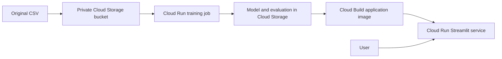

# Book Genre Predictor

A small Streamlit application that predicts a book's genre from its summary. A scikit-learn TF-IDF and logistic regression pipeline is trained in a Cloud Run job; the fitted pipeline is bundled into the public Cloud Run service.



## Dataset and model

The [Book Genre Prediction dataset](https://www.kaggle.com/datasets/athu1105/book-genre-prediction) is a UTF-8 CSV containing 4,657 rows and ten single-label genres. The input is `summary`; the `title` and `index` fields are not used. Whitespace is normalized; missing summaries or labels are removed. Exact duplicates after case and whitespace normalization are collapsed; summaries associated with different genres are excluded. Near-duplicates beyond this normalization may remain. A fixed-seed (43), stratified 80/20 split is made after deduplication.

The model combines word unigram and bigram TF-IDF (up to 50,000 features) with class-balanced logistic regression. This inexpensive baseline provides probability estimates and requires no external prediction service. The full fitted pipeline is serialized with joblib. Only load artifacts from this project's trusted bucket: joblib can execute code during loading.

## Evaluation

Cloud Run execution `book-genre-training-6wdk5` trained on 3,556 summaries and evaluated on 890. Accuracy was **72.1%**, macro F1 **68.9%**, and weighted F1 **72.1%**. Per-genre F1 ranged from 57.1% for romance to 76.7% for fantasy. The 43-seed test split was used after an exploratory comparison on a different split; these results are an estimate on this dataset, not a guarantee for new books. The full classification report and confusion matrix are in the bucket's `models/latest/evaluation.json`.

## Google Cloud

The project is `book-genre-classifier-515119`, region `us-east1`. The private bucket is `book-genre-classifier-515119-book-genre-private`; the image repository is `book-genre-images`. The job is `book-genre-training`, and the service is `book-genre-predictor`. Separate service accounts are used for training and serving; only the training account has bucket object access. The web service scales from zero to two instances. Cloud Build and stored images, objects, logs, and requests may incur charges.

## Setup and training

Use Python 3.11 and an authenticated `gcloud` CLI with the project selected and billing enabled. Place the extracted dataset at `data/raw/data.csv`.

```bash
gcloud config set project book-genre-classifier-515119
./scripts/setup_gcp.sh
./scripts/deploy_training.sh
```

Setup enables APIs, creates the private bucket, image repository and service accounts if absent, and uploads the original CSV. The training script builds an image, deploys and executes the job, and checks for `models/latest/model.joblib` and `models/latest/evaluation.json` in the bucket. The evaluation JSON contains dataset counts, accuracy, macro and weighted F1, per-class metrics, and the confusion matrix. Download it with:

```bash
gcloud storage cp gs://book-genre-classifier-515119-book-genre-private/models/latest/evaluation.json artifacts/evaluation.json
```

## Run locally

After the cloud job has produced a model:

```bash
python3.11 -m venv .venv
source .venv/bin/activate
pip install -r requirements.txt
mkdir -p artifacts
gcloud storage cp gs://book-genre-classifier-515119-book-genre-private/models/latest/model.joblib artifacts/model.joblib
PYTHONPATH=. streamlit run src/app/app.py
```

Run the automated tests with `python -m pytest -q`.

## Redeploy

```bash
./scripts/deploy_app.sh
```

This downloads the latest model from the private bucket, builds an image containing it, and deploys the public service. Retrain first to publish a new model. The app does not access the bucket or retrain at runtime.

## Cleanup

Run `./scripts/cleanup.sh` and type `DELETE` when prompted. It deletes the named service, training job, image repository and images, private bucket and all its objects, and the two project-specific service accounts. Cloud Build's automatically created source bucket, build history, logs, and enabled APIs are not removed by this script; review them separately if needed. The dataset bucket currently has a seven-day soft-delete retention policy, so deleted objects may remain recoverable and incur storage charges during that period. The command does not disable billing.

## Limitations

The genres are unevenly represented, summaries may include title or plot cues, and exact-match deduplication does not catch paraphrases. Predictions reflect this dataset and may not generalize to other books. The displayed probabilities are model estimates, not calibrated confidence or guaranteed accuracy. Input is processed in memory by the running service; there are no accounts or saved prediction history.
